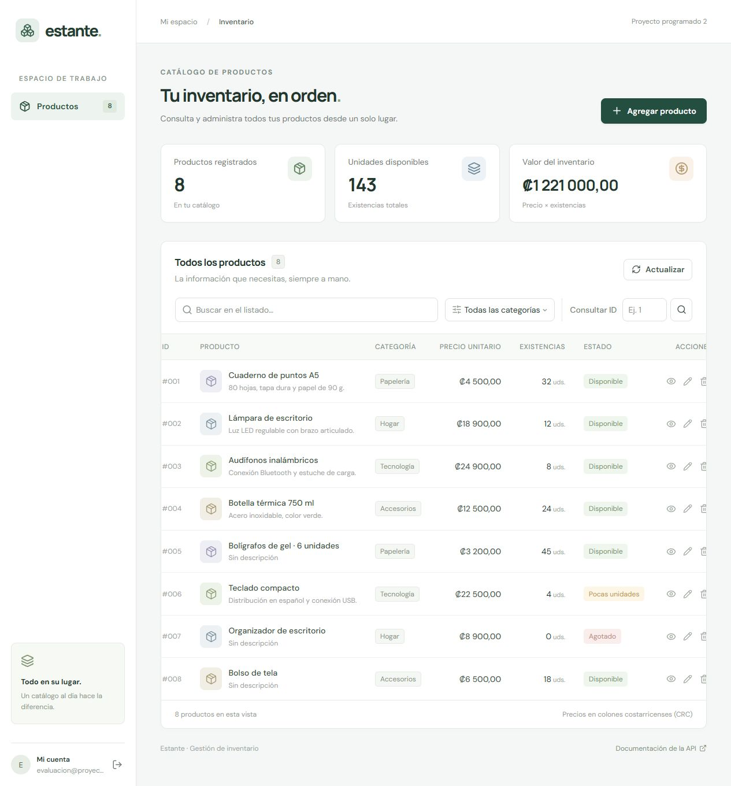

# Verificación · Proyecto programado 2

Fecha: 20 de noviembre de 2026 (Costa Rica).

## API local con SQL Server real

Ejecutado `scripts/test-api.mjs` contra `http://localhost:5082`, conectado a la base `ProyectoProgramado2` de SQL Server local.

- Listado sin autenticación: 401.
- Credenciales incorrectas: 401; credenciales correctas: token válido.
- Listado completo: 200 y arreglo de productos.
- Datos inválidos: 400 ante nombre vacío, precio negativo o con más de dos decimales, existencias negativas o fraccionarias y campos faltantes.
- Alta: 201 con identificador nuevo.
- Consulta por ID: 200 y datos coincidentes.
- Persistencia: el producto aparece en una nueva consulta del listado.
- Actualización: 200; nueva consulta confirma nombre, precio y existencias modificados.
- Eliminación sin token: 401.
- Eliminación autenticada: 204; consulta posterior: 404 y ausencia en el listado.
- El producto temporal del verificador fue eliminado.

## Interfaz React local

- Inicio de sesión correcto desde el formulario.
- Validación HTML de nombre obligatorio al intentar guardar un formulario vacío.
- Alta desde el formulario: producto temporal #10, confirmado en el listado.
- Recarga completa de la página: la sesión y el producto persisten.
- Edición desde la interfaz: nombre, precio y existencias actualizados.
- Consulta mediante el campo ID: recupera el producto actualizado.
- Diálogo de eliminación muestra nombre e identificador.
- Cancelar eliminación conserva el producto.
- Confirmar eliminación borra el producto; consultar su ID muestra el error 404 en español.
- API detenida temporalmente: el botón Actualizar muestra el mensaje de error de conexión.
- Búsqueda por nombre y estado sin resultados verificados.
- Filtro de Tecnología: muestra los dos productos correspondientes.
- Solución abierta y ejecutada desde Visual Studio con Ctrl+F5. Compilación: 1 proyecto correcto, 0 errores.
- Paquete de publicación generado con React en `wwwroot`.
- Paquete compilado ejecutado localmente en entorno Production, puerto 5083: HTML y recursos de React devuelven 200; el ciclo completo del verificador de API aprueba con SQL Server real.
- Diseño móvil comprobado: el ancho de la página coincide con el área visible; la tabla tiene desplazamiento horizontal dentro de su contenedor.
- Auditorías de dependencias npm y NuGet: sin vulnerabilidades reportadas por las fuentes consultadas.

## Estado de publicación

**Publicación completada y verificada el 20 de noviembre de 2026.**

- React: https://estante-proyecto2.tryasp.net/
- API: https://estante-proyecto2.tryasp.net/api/productos
- Swagger: https://estante-proyecto2.tryasp.net/swagger/
- OpenAPI: https://estante-proyecto2.tryasp.net/openapi/v1.json
- Repositorio: https://github.com/Jeisonar/proyecto-programado-2-react, rama `main`.

El sitio se ejecuta en MonsterASP.NET con ASP.NET Core 10 y SQL Server 2025 remoto. `GET /api/salud` devuelve 200 y confirma el acceso a SQL Server. El certificado HTTPS está activo; HTTP redirige a HTTPS con 307. Swagger y la especificación OpenAPI devuelven 200.

## API publicada

Ejecutado `scripts/test-api.mjs` directamente contra `https://estante-proyecto2.tryasp.net`, con resolución DNS normal y validación TLS. Aprobaron las verificaciones de acceso protegido, credenciales incorrectas y correctas, listado, datos inválidos, alta, consulta por ID, persistencia, edición y eliminación. El registro temporal se eliminó al terminar.

## Interfaz React publicada

Pruebas realizadas desde el navegador sobre el sitio HTTPS público:

| Funcionalidad | Resultado observado |
| --- | --- |
| Validación de credenciales | La contraseña incorrecta muestra un error en español; la correcta inicia sesión. |
| Listado | Se cargan los ocho productos iniciales desde la API. |
| Campos obligatorios | Un formulario vacío no se puede enviar; el nombre se marca como requerido. |
| Agregar | El formulario crea el producto temporal #11 y muestra la confirmación de guardado en la base. |
| Persistencia | Después de recargar la página, la sesión se conserva y el producto sigue disponible para editar. |
| Actualizar | Se cambian nombre, precio y existencias desde el formulario y aparece el mensaje de éxito. |
| Consultar por ID | La consulta del ID 11 muestra el nombre actualizado, precio ₡4 999,75 y nueve unidades. |
| Confirmar eliminación | El diálogo identifica el nombre y el ID del producto y advierte que la eliminación es definitiva. |
| Cancelar eliminación | El producto permanece en el listado. |
| Eliminar | Al confirmar, el producto desaparece y se muestra el mensaje de éxito. |
| Registro inexistente | Consultar el ID eliminado muestra «No existe un producto con el identificador 11». |
| Filtro por categoría | Tecnología muestra los dos productos correspondientes. |
| Detalle | Se consulta el producto #1 y se muestran nombre, categoría, precio, existencias, descripción y actualización. |

Al finalizar quedaron los ocho productos de ejemplo, 143 unidades y un valor total de ₡1 221 000,00. No quedaron registros de verificación. Los errores de conexión se probaron localmente con el mismo cliente React compilado; en la publicación no se interrumpió el servicio para simular una caída.

